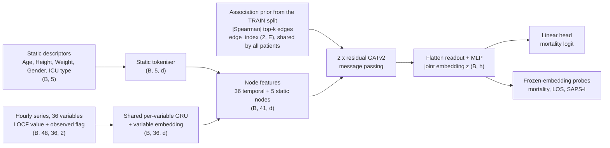
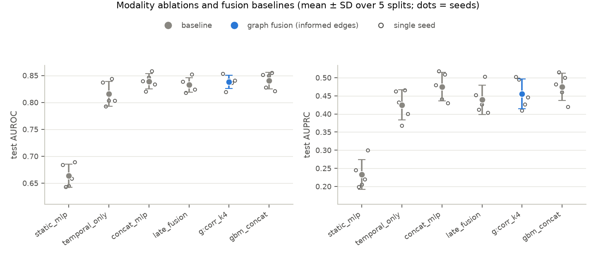
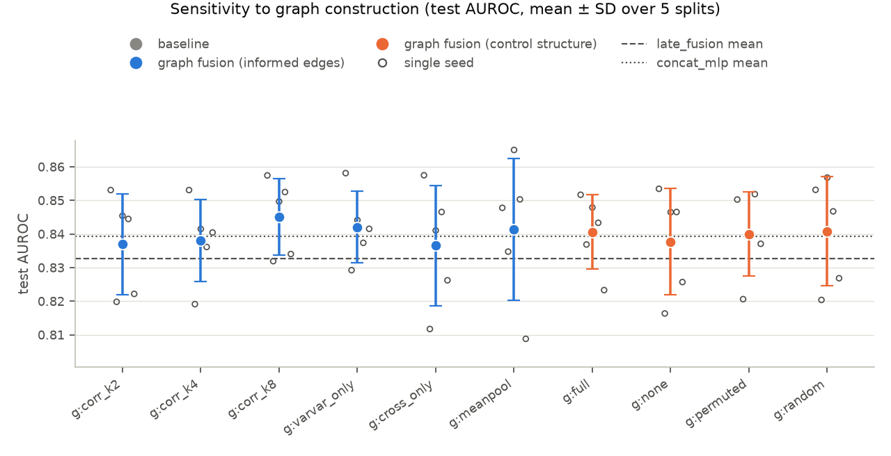
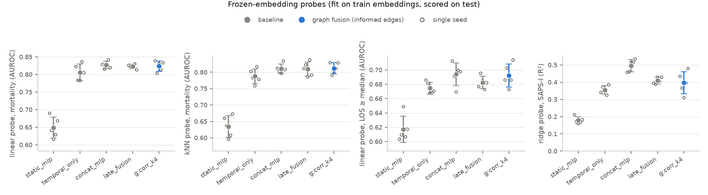

# Temporal-Static Graph Fusion for Multimodal Representation Learning

A small, controlled study of one question that comes before any graph-conditioned generative model:

> Does putting static (tabular) and temporal (time-series) information into **one graph** give a more useful
> joint representation than concatenation or independent encoders — and does the graph *structure* matter?

The graph model is compared with concatenation and late-fusion baselines, and against capacity-matched controls
with absent or deliberately wrong inter-node structure (isolated nodes, random edges, shuffled node identities,
and all pairs).

**Short answer from the runs reported below:** adding the static modality improved AUROC in every repeated split,
but the tested graph structure did not add a meaningful advantage. The informed graph performed like the
isolated-node, random-edge and permuted-edge controls in both the CPU (4,000 stays) and GPU (12,000 stays) runs.
See [Results](#results) for the numbers and caveats.

## Data

**PhysioNet/Computing in Cardiology Challenge 2012** — ICU stays of ≥ 48 h. Per stay:

| modality | content |
|---|---|
| static | Age, Gender, Height, Weight, ICU type (5 descriptors, some missing) |
| temporal | 36 irregularly sampled variables (vital signs, labs, GCS, urine, …) over 48 h, binned hourly → `(48, 36)`, ~81 % missing |
| label | in-hospital death (≈ 14 % positive) |

- Page and files: <https://physionet.org/content/challenge-2012/1.0.0/> — open access, no login. The dataset is made available under the [Open Data Commons Attribution License v1.0](https://physionet.org/content/challenge-2012/view-license/1.0.0/).
- Cite: Silva I, Moody G, Scott DJ, Celi LA, Mark RG. *Predicting In-Hospital Mortality of ICU Patients: The PhysioNet/Computing in Cardiology Challenge 2012.* Computing in Cardiology 2012;39:245–248; and Pollard T et al., *PhysioNet as a global platform for biomedical research.* Nature Health (2026), <https://doi.org/10.1038/s44360-026-00096-z>.
- The data are **not** in this repository; `python -m tsgf.data` downloads `set-{a,b,c}.tar.gz` and `Outcomes-*.txt` (≈ 7 MB each).
- ICU data are used here as a **methodological benchmark** for static + irregular-time-series fusion, not as a clinical study. Nothing here is validated for clinical use. Demographic fields are present, but no subgroup or fairness analysis is performed; these results are not evidence about equitable performance. Why this dataset and not a wearable one: [docs/design_decisions.md](docs/design_decisions.md).

## Method



- **Nodes**: one per dynamic variable (learned summary of its series) and one per static descriptor (learned token).
- **Edges**: population-level association, estimated on training patients only and without labels — variable–variable
  (top-4 |Spearman| neighbours) and static–variable (each descriptor to its top-6 variables). It is a statistical prior, not a causal claim.
  The strongest edges found (e.g. `NIDiasABP–NIMAP`, `DiasABP–MAP`, `ALT–AST`, `BUN–Creatinine`) are physiologically sensible.
- **Temporal encoder**: one GRU with weights shared across variables (chosen so the temporal side decomposes into nodes).
- Formalisation: [docs/problem_formulation.md](docs/problem_formulation.md).

### Models compared

| name | what it is |
|---|---|
| `static_mlp`, `temporal_only` | single-modality ablations |
| `concat_mlp` | baseline 1: per-variable summary features + static vector → MLP |
| `late_fusion` | baseline 2: same temporal encoder + static MLP, embeddings concatenated |
| `graph_corr_k4` | **graph fusion** with the informed graph |
| `graph_none / _random / _permuted / _full` | structure controls with identical parameter count (no inter-node edges / same edge count at random / same topology with shuffled node identities / all pairs) |
| `graph_varvar_only`, `graph_cross_only`, `graph_corr_k2/k8`, `graph_meanpool` | sensitivity of edge type, density and readout |
| `gbm_concat` | gradient-boosting reference on the `concat_mlp` features |

## Results

Test AUROC, mean ± sample SD over 5 random stratified splits (each seed = new split and new initialisation).
The splits reuse many of the same stays and are not independent samples; these SDs are descriptive and are not
confidence intervals. Everything below was produced by the code in this repository; raw per-run numbers are in
`results/*/results.csv`.

### Quick mode — CPU, set-a (N = 4,000), `configs/quick.yaml`

| model | test AUROC | test AUPRC | probe: mortality (AUROC) | probe: LOS ≥ median | probe: SAPS-I R² | params |
|---|---|---|---|---|---|---|
| `static_mlp` | 0.664 ± 0.022 | 0.233 ± 0.041 | 0.649 ± 0.030 | 0.617 ± 0.018 | 0.179 ± 0.019 | 5,185 |
| `temporal_only` | 0.816 ± 0.023 | 0.425 ± 0.042 | 0.806 ± 0.024 | 0.675 ± 0.008 | 0.355 ± 0.024 | 82,689 |
| `concat_mlp` | 0.839 ± 0.014 | 0.475 ± 0.039 | 0.827 ± 0.010 | 0.694 ± 0.016 | 0.496 ± 0.035 | 16,705 |
| `late_fusion` | 0.833 ± 0.013 | 0.439 ± 0.040 | 0.823 ± 0.006 | 0.682 ± 0.009 | 0.409 ± 0.019 | 87,745 |
| **`graph_corr_k4`** | 0.838 ± 0.012 | 0.455 ± 0.041 | 0.824 ± 0.015 | 0.692 ± 0.016 | 0.397 ± 0.065 | 98,017 |
| `gbm_concat` (reference) | 0.841 ± 0.015 | 0.475 ± 0.037 | – | – | – | – |

Graph-construction sensitivity (same 98,017 parameters except `meanpool`):

| graph | test AUROC | | graph | test AUROC |
|---|---|---|---|---|
| informed, k=2 | 0.837 ± 0.015 | | **isolated nodes (no inter-node edges)** | 0.838 ± 0.016 |
| informed, k=4 | 0.838 ± 0.012 | | random (same edge counts) | 0.841 ± 0.016 |
| informed, k=8 | 0.845 ± 0.011 | | permuted (same topology, shuffled identities) | 0.840 ± 0.013 |
| variable–variable edges only | 0.842 ± 0.011 | | all pairs | 0.841 ± 0.011 |
| cross-modal edges only | 0.837 ± 0.018 | | informed, mean-pool readout (18k params) | 0.841 ± 0.021 |

Paired differences in test AUROC (same split and seed; A − B, mean, SD of the difference, seeds with A > B):

| A vs B | mean Δ | SD of Δ | A > B |
|---|---|---|---|
| `late_fusion` vs `temporal_only` | +0.017 | 0.012 | 5/5 |
| `graph_corr_k4` vs `late_fusion` | +0.006 | 0.013 | 4/5 |
| `graph_corr_k4` vs `concat_mlp` | −0.001 | 0.014 | 2/5 |
| `graph_corr_k4` vs `graph_none` | +0.000 | 0.010 | 2/5 |
| `graph_corr_k4` vs `graph_permuted` | −0.002 | 0.008 | 3/5 |
| `graph_corr_k4` vs `graph_random` | −0.003 | 0.011 | 1/5 |





Full tables: [results/quick/summary.md](results/quick/summary.md).

### Full mode — GPU (RTX 2060), sets a+b+c (N = 12,000), wider model, `configs/full.yaml`

Same protocol, 5 splits, about 8,400 training stays per split, `d_node=64`, `d_hidden=128`.

| model | test AUROC | test AUPRC | probe: mortality (AUROC) | probe: LOS ≥ median | probe: SAPS-I R² | params |
|---|---|---|---|---|---|---|
| `static_mlp` | 0.692 ± 0.009 | 0.249 ± 0.006 | 0.690 ± 0.008 | 0.622 ± 0.012 | 0.201 ± 0.019 | 18,561 |
| `temporal_only` | 0.852 ± 0.012 | 0.533 ± 0.027 | 0.844 ± 0.019 | 0.721 ± 0.011 | 0.418 ± 0.028 | 327,169 |
| `concat_mlp` | 0.866 ± 0.009 | 0.551 ± 0.019 | 0.858 ± 0.011 | 0.719 ± 0.013 | 0.576 ± 0.039 | 41,601 |
| `late_fusion` | 0.866 ± 0.008 | 0.551 ± 0.028 | 0.854 ± 0.010 | 0.724 ± 0.014 | 0.478 ± 0.025 | 345,473 |
| **`graph_corr_k4`** | 0.865 ± 0.011 | 0.559 ± 0.035 | 0.857 ± 0.011 | 0.724 ± 0.012 | 0.430 ± 0.023 | 386,497 |
| `gbm_concat` (reference) | 0.870 ± 0.013 | 0.563 ± 0.035 | – | – | – | – |

Structure controls (same 386,497 parameters): none 0.864 ± 0.014, random 0.866 ± 0.013, permuted 0.866 ± 0.014,
all pairs 0.862 ± 0.014, informed k=2 / 4 / 8: 0.865 / 0.865 / 0.866, variable–variable only 0.867, cross-modal only 0.866,
informed with mean-pool readout (67k parameters) 0.866.

Paired differences in test AUROC (A − B; mean, SD of the difference, seeds with A > B):

| A vs B | mean Δ | SD of Δ | A > B |
|---|---|---|---|
| `late_fusion` vs `temporal_only` | +0.013 | 0.006 | 5/5 |
| `graph_corr_k4` vs `late_fusion` | −0.001 | 0.003 | 2/5 |
| `graph_corr_k4` vs `concat_mlp` | −0.001 | 0.007 | 3/5 |
| `graph_corr_k4` vs `graph_none` | +0.001 | 0.004 | 3/5 |
| `graph_corr_k4` vs `graph_permuted` | −0.001 | 0.003 | 2/5 |
| `graph_corr_k4` vs `graph_random` | −0.001 | 0.004 | 1/5 |
| `graph_corr_k4` vs `graph_full` | +0.003 | 0.004 | 4/5 |

The largest observed gap between the informed graph and any control is +0.003 AUROC (vs. the all-pairs graph, 4 of 5 seeds),
which is small relative to the descriptive repeated-split variation; no control is beaten in AUPRC consistently either. (The GPU run was launched in two invocations of the same config —
first a 10-experiment subset for 3 seeds, then the resumable runner filled in the rest — visible in `results/full/run.log`.) Figures and full tables:
[results/full/summary.md](results/full/summary.md) (`fig_*.png` alongside).


### How the stated hypotheses fared ([docs/problem_formulation.md §6](docs/problem_formulation.md))

| | claim | outcome |
|---|---|---|
| H1 | graph fusion beats concatenation and late fusion | **not supported**: quick +0.006 over `late_fusion` (paired SD 0.013), −0.001 vs `concat_mlp`; full −0.001 and −0.001 |
| H2 | informed graph beats isolated-node / random / permuted controls | **not supported**: all controls within ±0.003 AUROC in both modes (largest gap +0.003 vs all-pairs, full mode) |
| H3 | graph embeddings give better probe scores | **not supported**: comparable to baselines in both modes; `concat_mlp` retains more SAPS-I information (R² 0.50 vs 0.40 quick, 0.58 vs 0.43 full) |
| H4 | cross-modal edges matter most | **not supported**: `varvar_only` vs `cross_only` 0.842 vs 0.837 (quick), 0.867 vs 0.866 (full), within noise |

### Interpretation and caveats

- What the data support: adding the static modality to the temporal model improves AUROC in every split in both modes (`late_fusion` vs `temporal_only`: +0.017 quick, +0.013 full), and every fusion variant lands in a narrow band (≈ 0.83–0.85 quick, ≈ 0.86–0.87 full).
  Hand-crafted summary features with an MLP or gradient boosting are as good as any neural model here.
- What they do **not** support: a meaningful benefit from the tested graph connectivity. Removing inter-node edges, randomising them or shuffling node identities produced similar results.
- Resolution: with 5 overlapping splits, the descriptive SD of paired differences is ≈ 0.01 AUROC in quick mode and ≈ 0.003–0.007 in full mode. The runs do not establish statistical equivalence, and effects of a few thousandths of AUROC remain unresolved.
- The static modality has only 5 fields; a richer one could behave differently. One dataset, one target, one temporal encoder, untuned shared hyper-parameters,
  and parameter counts that are not matched between baselines and graph models (reported in the tables). Splits are random draws, not the challenge split, so numbers are not comparable to challenge scores. The hypotheses and interpretation criteria are documented, but this was not a timestamped preregistration.
- Probes are fit on embeddings of supervised models, so they show what supervised training retained, not label-free representation quality.
- Leakage considerations (train-only statistics and graph, outcome-derived scores used as probe targets only, informative missingness): see [docs/interview_guide.md §7](docs/interview_guide.md).

## Reproduce

Python ≥ 3.11 (developed and run with 3.12). For GPU use, install the PyTorch build appropriate for your
platform first ([pytorch.org](https://pytorch.org/get-started/locally/)); the project install will reuse it.

```bash
pip install -r requirements.txt
python -m pytest                                      # 31 tests, no download needed (synthetic data)
python -m tsgf.run --config configs/quick.yaml        # CPU; downloads set-a on first use (~1.1 h of training in total on a 6-core desktop CPU)
python -m tsgf.report --results results/quick         # tables + figures
python -m tsgf.run --config configs/full.yaml         # GPU (device: auto), sets a+b+c, 5 seeds (~1 h on an RTX 2060)
python -m tsgf.report --results results/full
```

Quick check (~2 min): `python -m tsgf.run --config configs/quick.yaml --seeds 0 --epochs 2 --only static_mlp,concat_mlp,graph_corr_k4 --output-dir results/smoke`.

- Determinism: every seed sets Python/NumPy/PyTorch seeds; splits, graphs and initialisations are derived from the seed.
  On CPU, two runs give identical numbers (tested). On GPU, scatter operations in message passing can add tiny nondeterminism.
- Runs are resumable: finished `(experiment, seed)` pairs in `results.csv` are skipped.
- Every run writes `run.log`, `config_used.yaml`, `environment.json`, `results.csv` next to its outputs.

## Repository layout

```
tsgf/data.py        download, parsing, split, train-only preprocessing
tsgf/graph.py       association matrices, informed and control graphs
tsgf/models.py      baselines and GraphFusion (PyTorch Geometric GATv2)
tsgf/train.py       training loop, early stopping
tsgf/evaluate.py    embedding probes
tsgf/run.py         experiment runner       tsgf/report.py   tables and figures
configs/            quick.yaml (CPU), full.yaml (GPU)
tests/              31 pytest tests on synthetic data
results/quick/      real outputs of the quick run (csv, log, summary, figures)
results/full/       real outputs of the GPU run
docs/               formulation, design decisions, experiment plan, interview guide, learning roadmap
```

## Documents

[Problem formulation](docs/problem_formulation.md) · [Design decisions](docs/design_decisions.md) ·
[Experiment plan](docs/experiment_plan.md) · [Interview guide](docs/interview_guide.md) · [Learning roadmap](docs/learning_roadmap.md)

## Not done

No diffusion or reconstruction experiment (deliberately, to isolate the fusion question), no encoder comparison,
no hyper-parameter search, no learned adjacency, no low-data regime study (the most informative next step, see the interview guide).

## License

Code copyright © 2026 Farzam Nikbakhsh Jorshari, released under the MIT License. The downloaded dataset is not
redistributed and remains separately licensed under ODC-By 1.0.
